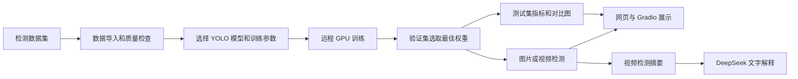

# ODPlatform 算法工程师工作说明

本文根据当前项目代码与已有实验记录整理，适用于项目分工说明、代码讲解和答辩准备。内容以港区水域目标检测为主，覆盖 D5 训练配置、D7 可视化、模型推理、实验记录和效果验收。整理日期：2026 年 10 月 28 日。

## 1. 工作范围和项目目标

算法工程师负责将数据工程师准备好的目标检测数据用于模型训练和推理，记录训练过程，评估检测效果，并把结果交给界面展示。主要工作可以概括为：

1. 定义和校验模型、数据集、训练轮次、图像尺寸、批大小等参数。
2. 在远程 GPU 上训练 YOLOv8，记录训练过程和权重。
3. 使用测试数据计算检测指标，生成类别统计和对比图。
4. 支持图片和视频目标检测，并可选择本机 CPU 或远程 GPU 推理。
5. 提供训练监控、检测框和视频结果可视化，并接入 Gradio 演示界面。
6. 对配置生成和可视化等功能进行自动测试，管理历史运行产物。

数据工程师负责数据接入、数据格式处理和质量检查；Web 工程师负责页面与接口；LLM 工程师负责 DeepSeek 解释能力。实际页面由多个角色共同完成，界面上的检测结果来自算法模块，页面交互由 Web 层提供。

## 2. 项目整体流程

训练任务使用已就绪的数据集，训练过程中记录每轮指标；训练结束后，使用选定权重评估测试集并生成结果。图片或视频推理复用已有权重。DeepSeek 接收的是整理后的检测摘要，其解释不等于对原始视频做人工标注，也不能代替独立测试。

## 3. D5：训练配置与参数管理

### 3.1 为什么需要集中管理参数

目标检测效果受模型大小、输入尺寸、学习率、轮次、批大小和数据增强等因素影响。若这些参数分散在脚本中，容易出现不同实验参数无法对照、错误输入直到训练过程中才被发现、训练结果难以复现等问题。

项目使用 `DetectionConfig` 集中定义 YOLO 检测参数，并通过 Pydantic 限制参数类型和取值范围。参数模型位于 `apps/platform/src/od_platform/runtime_config/detection.py`。

### 3.2 当前 YOLO 检测默认参数

| 参数 | 默认值 | 含义和影响 |
| --- | --- | --- |
| `backend` | `yolo` | 使用目标检测后端。 |
| `data` | `wsodd` | 默认数据集标识；实际训练可在界面选择其他已就绪的检测数据集。 |
| `architecture` | `yolov8n.pt` | 模型规模；配置支持 n、s、m 三种型号。规模增大通常带来更多计算和显存开销，效果需实验验证。 |
| `device` | `cuda` | 完整训练使用远程 CUDA GPU。 |
| `epochs` | 50 | 训练轮数。更多轮次不一定带来更好的泛化效果。 |
| `batch_size_train` | 16 | 每批训练图片数量。过大可能造成显存不足。 |
| `batch_size_test` | 16 | 测试批大小。 |
| `imgsz` | 640 | 模型输入图像尺寸。更大尺寸保留更多小目标细节，也会增加耗时和显存。 |
| `optimizer` | AdamW | 优化模型权重的方法；也支持 SGD。 |
| `lr` | 0.001 | 初始学习率，控制参数更新幅度。 |
| `weight_decay` | 0.0005 | 权重衰减，用于正则化。 |
| `mosaic` | 1.0 | Mosaic 数据增强概率。 |
| `close_mosaic` | 10 | 训练结束前关闭 Mosaic 的轮次数；实际传入值不会超过总轮数。 |
| `seed` | 42 | 随机种子，用于控制随机过程；不保证不同硬件和环境得到完全相同结果。 |
| `threshold` | 0.25 | 图片、视频预测结果展示时使用的置信度阈值。 |
| `iou` | 0.7 | 相关预测或评估过程的 IoU 参数，具体意义取决于 Ultralytics 接口。 |

以上为配置默认值，不代表每一次实验都使用它们。`apps/platform/configs/runtime/wsodd_accuracy.yaml` 是另一套小目标精度实验方案，包含 YOLOv8s、960 输入尺寸、60 轮和 batch 16；`wsodd_fast_4090.yaml` 是以较短训练时间为目标的方案。方案名称或参数本身不保证一定达到精度或时间目标，需要实际测试。

### 3.3 参数校验与配置复用

配置模型限制训练轮次、输入尺寸、批大小等范围，同时禁止未定义字段。这样可以在接收训练请求时提示参数错误，避免错误配置进入训练。

`apps/platform/src/od_platform/runtime_config/__init__.py` 中的 `_build_config()` 提取了训练、验证和推理配置构建过程中的公共逻辑；各自的 `build_train_config`、`build_val_config` 和 `build_infer_config` 入口继续保留。这降低了重复维护的成本，也让相同配置处理更一致。

`generator.py` 用于生成配置模板。现有 pytest 测试覆盖正常生成、已存在文件时跳过、覆盖备份、空字符串、特殊字符及 YAML 解析回读等情形，防止生成配置时意外改写用户内容或改变数据类型。

## 4. YOLO 训练执行

主要实现位于 `apps/platform/src/od_platform/training/detection_experiment.py`，训练由 Django 任务接口提交并在远程环境执行。

### 4.1 训练前

1. 检查数据集是否已经就绪，检测任务与数据标注类型是否匹配。
2. 检查数据质检报告和数据指纹；出现阻断性错误或数据身份不一致时，不开始训练。
3. 加载所选 YOLO 架构和参数，将数据准备到训练引擎可使用的目录。
4. 完整训练要求远程 CUDA；本机 CPU 在当前实现中只用于显式选择的 YOLO 推理。

这里的数据指纹用于确认训练使用的数据与记录中的数据一致，并不单独证明训练集、验证集和测试集在采集场景上彼此独立。

### 4.2 训练中

项目通过训练回调记录当前轮次、批次、进度和每轮训练／验证指标。状态持续写入任务记录，因此页面可以展示训练进度、曲线和错误信息。训练支持取消请求；具体停止时机取决于训练流程检查取消标记的位置。

训练参数会转换为 Ultralytics 所需的格式，包括模型大小、图像尺寸、优化器、学习率、数据增强、缓存和工作进程数量等。训练使用预训练模型，并保存运行产物与最佳权重。

### 4.3 训练结束后

训练完成后，流程读取 `best.pt`，在配置的测试集上计算总体和各类别指标，并保存报告、训练曲线及部分图片对比图。报告记录数据指纹和权重 SHA-256，便于核对结果来源。测试集不用于训练流程中的权重选择；但测试是否具备独立场景价值，仍取决于数据本身的划分。

## 5. 评估指标怎么理解

| 指标 | 含义 | 使用时应注意 |
| --- | --- | --- |
| Precision（精确率） | 检测为目标的结果中，有多少与标注匹配。 | 高精确率不代表没有漏检。 |
| Recall（召回率） | 已标注目标中，有多少被检测到。 | 高召回率也可能伴随更多误检。 |
| IoU | 预测框与真实框的交集面积除以并集面积。 | 框越吻合，IoU 通常越高。 |
| AP50 | 在 IoU 0.50 条件下，单类别精确率—召回率曲线的平均精度。 | 某类别缺少标注时，不能把总体均值当成该类别的 AP。 |
| mAP50 | 各可评估类别 AP50 的平均值。 | 类别数量少、类别样本不均衡时，需要同时查看每类结果。 |
| mAP50–95 | 对多个 IoU 阈值（0.50 至 0.95）下的 AP 求平均。 | 对检测框位置更严格，通常低于 mAP50。 |

程序的测试报告使用 Ultralytics 的检测评估流程，报告中的整体 F1 是整体 Precision 和 Recall 的调和平均；它不应直接等同于固定阈值下其他任务的 F1。测试时使用较低的置信度下限来计算检测 AP；页面展示检测框时默认阈值为 0.25。两者服务于不同目的，不能把显示阈值直接解释为模型测试精度。

## 6. 图片和视频推理

### 6.1 图片检测

用户选择已完成训练的 YOLO 权重，上传图片，选择本机 CPU 或远程 GPU 并设置置信度阈值。模型输出目标框、类别和置信度，程序保存可视化图片和预测记录。

检测框上的 `0.67` 等数字是模型对该次预测的置信度，不是模型在测试集上的准确率。降低阈值可能发现更多低置信度目标，也可能增加误检；是否改善需要有标注的数据进行对照评估。

### 6.2 视频检测

视频推理位于 `apps/platform/src/od_platform/training/video_detection.py`。程序检查视频信息后逐帧运行 YOLO，保存帧级检测数据和抽样图，再生成可播放的 H.264 标注视频。任务状态包含处理帧数、进度和编码阶段。

当前实现会统计类别出现的帧数、单帧最多同时出现数量和最高置信度。由于没有目标跟踪 ID，**出现 100 帧不代表有 100 个不同目标**；未标注视频也不能直接算 Precision、Recall 或 mAP，不能据此判断航速或碰撞风险。

本机 CPU 推理由独立工作进程处理，关闭网页不会自动停止已经提交的任务，但电脑和后端进程仍需保持运行。远程 GPU 推理依赖远程实例和网络连接。

## 7. D7：可视化和界面对应

### 7.1 可视化内容

- **训练曲线**：按 Epoch 展示训练损失、验证损失、mAP50 和 mAP50–95。
- **测试报告**：展示整体指标、每类别指标和标注样本数量。
- **图片对比**：将真实标注框（GT）与模型预测框放在同一张对比图中，便于观察漏检、误检和定位偏差。
- **视频结果**：展示带检测框的视频、抽样帧以及逐帧统计摘要。
- **任务进度**：展示训练、测试、推理、编码等阶段的实际状态。

完整测试指标使用测试集计算；可视化仅选取部分样本展示，因此不能只凭几张效果图判断整体精度。

### 7.2 用户从哪里查看

| 入口 | 算法相关内容 |
| --- | --- |
| Django 工作台 `/` 的“监控概览” | 训练参数入口、进度、损失曲线、验证指标和运行环境。 |
| “实验记录” | 训练、图片和视频任务状态及历史记录。 |
| “结果可视化” | 检测框、对比图片及评估指标。 |
| “视频分析” | 上传媒体、选择权重和运行位置、查看检测结果与文字解释。 |
| “运行维护” | 查看和管理历史训练、推理产物。 |
| Streamlit 算法工作台 | 训练监控、数据质量、图片与视频检测、结果浏览。 |
| Gradio 演示界面 | 数据集导入、远程 GPU 训练、图片／视频检测及结果查看。 |

本机常用地址分别为 `http://127.0.0.1:8000/`、`http://127.0.0.1:8501/` 和 `http://127.0.0.1:7860/`。对应服务必须启动；`127.0.0.1` 只表示访问者自己的电脑，不能直接作为公网地址分享。

## 8. 运行结果和清理策略

模型训练和推理会生成日志、图片、视频、模型权重和审计信息，长期保存可能占用较多磁盘。`apps/platform/src/od_platform/common/retention.py` 提供保留策略、清理预览、隔离回收和恢复功能。

策略默认关闭。启用后可配置保留天数、保留最近运行数、空间目标及回收区保留时间。被任务记录引用的运行目录、正在运行的目录和无法确认完成状态的目录会优先保护。回收后的目录可以在保留期内恢复；不能把清理策略理解成自动删除所有旧实验。

## 9. 当前实验结果及其限制

根据 `docs/wsodd-val-test-mix-95-20261027.md`，已有一次扩展训练实验使用原训练集，并将原验证集和原测试集各随机抽取 95% 加入训练：

| 数据来源 | 原数量 | 加入训练 | 剩余 |
| --- | ---: | ---: | ---: |
| 原训练集 | 5638 | 5638 | — |
| 原验证集 | 1052 | 999 | 53 |
| 原测试集 | 777 | 738 | 39 |

该次实验从原最佳 YOLOv8s 权重开始微调 10 轮，输入尺寸 960，batch 32，使用 RTX 4090。记录结果如下：

| 对照数据 | mAP50 | mAP50–95 |
| --- | ---: | ---: |
| 剩余 53 张验证图 | 75.24% | 44.60% |
| 剩余 39 张测试图 | 74.70% | 41.37% |

这些数字仅描述上述小规模对照集合的结果。剩余图片与加入训练的图片存在采集组重叠，验证集还参与了本次模型选择；部分目标类别缺失或样本很少。因此，这些指标**不能作为未见新场景的独立验收精度**，也不能直接与原 777 张测试图片的整体结果比较。

下一步应按采集时间、摄像机或视频来源划分训练、验证和独立测试数据，检查跨集合重复和类别覆盖；固定测试集后，报告总体及逐类别指标，并针对小船、远距离目标等难例进行分析。10 分钟训练目标需要在同一数据、硬件和完整计时口径下验证，不能由模型名称或某组配置保证。

## 10. 测试与现状

项目已有 pytest 测试覆盖配置默认值、参数生成和 YAML 回读、可视化组件、Gradio 请求以及图片／视频流程等。最近一次代码提交前的自动检查通过了 Ruff、mypy 和完整 pytest；自动测试证明的是被测试行为符合断言，不证明模型对真实港区场景已经达到业务要求。

当前可以如实归纳为：D5 参数配置和测试、D7 可视化及 Gradio 演示入口已有实现；图片／视频支持本机 CPU 或远程 GPU 推理，完整训练使用远程 GPU。独立场景下的类别覆盖和模型效果仍需新的数据与实验验收。

## 11. 汇报时可以强调的特点

1. **参数配置规范化**：对检测参数集中定义、校验并保存训练配置，便于复现实验。
2. **实验过程可追踪**：训练过程记录轮次指标、权重哈希和数据指纹，结果与任务关联。
3. **可视化贯通训练和推理**：同时查看训练曲线、类别指标、GT／预测对比和标注视频。
4. **计算位置可选**：图片和视频检测支持本机 CPU 或远程 GPU，训练使用远程 GPU。
5. **产物管理有保护机制**：旧运行结果可预览、隔离与恢复，默认不自动清理。

以上属于工程实现和项目特点。目前代码与现有报告不足以证明提出了新的 YOLO 网络结构或原创注意力算法，也不足以证明在独立港区场景中达到某个精度目标。

## 12. 核心文件索引

| 文件 | 作用 |
| --- | --- |
| `apps/platform/src/od_platform/runtime_config/detection.py` | YOLO 检测参数定义和校验。 |
| `apps/platform/src/od_platform/runtime_config/__init__.py` | 训练、验证和推理配置构建。 |
| `apps/platform/src/od_platform/runtime_config/generator.py` | 配置文件模板生成。 |
| `apps/platform/src/od_platform/training/detection_experiment.py` | 检测训练、测试、状态记录与对比图。 |
| `apps/platform/src/od_platform/training/video_detection.py` | 视频逐帧推理与标注视频生成。 |
| `apps/platform/src/od_platform/visualization/` | 检测结果数据结构、绘制样式和可视化工具。 |
| `apps/platform/src/od_platform/common/retention.py` | 运行结果保留与回收。 |
| `apps/web-backend/src/od_web/gradio_demo.py` | Gradio 演示入口及 Django API 调用。 |
| `apps/streamlit/app.py` | Streamlit 算法工作台。 |
| `apps/platform/tests/runtime_config/` | 配置相关 pytest 测试。 |
| `apps/platform/tests/visualization/` | 可视化相关 pytest 测试。 |
| `tests/web/test_gradio.py` | Gradio 页面和请求行为测试。 |
| `docs/wsodd-val-test-mix-95-20261027.md` | 95% 扩展训练实验的参数、指标及限制。 |
